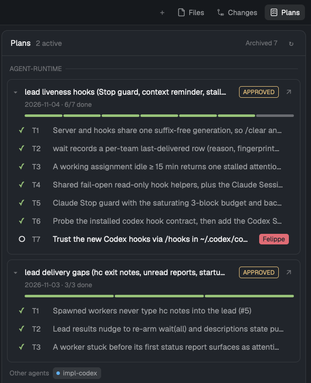

# Plans

Herdr's default window with a third side panel, **Plans**, beside Files and Changes. It shows
the spec-driven plans of the shown space's repo (`docs/plans/*.plan.md`, the format
`/start-planning` writes): each plan's status, a progress bar, its tickets with their state,
and the Herdr agents working on them. ↗ on a plan opens the plan file in the Files panel.

## What you see

- Everything from Herdr's `main` layout, unchanged: sidebar with spaces and agents, tab bar,
  panes as cards, status bar.
- Tab bar, right end: `+`, **Files**, **Changes**, then **Plans** (14px checklist icon, 12px
  label, 26px tall pill; `selected` background while open, `chrome` otherwise).
- The side panel (368px default, 280–900px) shows one of Files, Changes or Plans.
- Plans panel, top to bottom:
  - 42px header: **Plans** (semibold), then dim `N active · N awaiting approval`; on the
    right a small **Archived N** toggle and `↻`.
  - One uppercase dim label per repo (`AGENT-RUNTIME`) with a 1px rule.
  - One card per plan (`surface` background, 1px `border`, 8px radius, 10px padding):
    chevron, title (the `# Plan:` heading, truncated, semibold), status pill (1px border in
    the tone colour: AWAITING APPROVAL `blocked`, APPROVED `working`, others `dim`), `↗`.
    Under it, dim 11px `date · done/total done · N in progress · N blocked`, then a 4px
    progress bar with one segment per ticket in its state's colour (ready/waiting at 35%
    opacity).
  - Lead and plan-level agent chips under the bar (`lead · <tab name>`, worker names).
  - Ticket rows (28px): state glyph, ticket id (muted, 26px), what it delivers (truncated,
    backticks dropped), agent chips for workers on that ticket, and an owner badge when the
    owner is a person (not `agent`/`claude`/`codex`).
  - Under the cards: `Other agents` chips for workers in the repo that could not be placed.

## How it behaves

- **Which plans:** the active space's folder and its panes' folders resolve to a repo; worktrees
  resolve to their main checkout (`git rev-parse --git-common-dir`), so a plan shows once.
  Every copy is read: each worktree's `docs/plans` (`git worktree list`) and the default
  branch's tree (`origin/HEAD`, else `main`, via `git show`); a plan often exists only on the
  branches where work happens. The shown copy is the most advanced one (plan status, then
  complete tickets, ticket count, in-progress tickets, file time), and each ticket then takes
  its furthest state across copies (COMPLETE > IN PROGRESS > BLOCKED > TO-DO), since a lead marks
  IN PROGRESS on the ticket's branch and the default branch only learns COMPLETE.
  Switching spaces rescans. Plans without a `Status:` line and ARCHIVED plans are hidden until
  **Archived N** is on. Order: AWAITING APPROVAL, APPROVED, then newest date first.
- **Ticket states** from the Tickets table's Status cell: `COMPLETE…` ✓ (`ansi2` green);
  `IN PROGRESS` ◐ spinning natively (`.frames`, 220ms, `working`); `BLOCKED` ✕ (`blocked`);
  `TO-DO` is **Ready** ○ (`foreground`) when every `T<n>` in Blocked by is complete, else
  **Waiting** ○ (`dim`). A ready ticket owned by a person gets a solid `blocked` badge
  (it needs you).
- **Agents:** live local terminals with an agent or status, whose folder is in the repo.
  A worker (a terminal with a `parent`) whose name carries a ticket id (`t4-mcp`,
  `existence-t13b` → T4, T13) goes on that ticket, in the plan where it is in progress (else
  the first active plan that has it). Other workers go to the repo's only plan with a ticket in
  progress; if there isn't exactly one, they're listed as Other agents. A worker's parent shows
  as the plan's lead. Chip dot: working (pulsing opacity loop), blocked, done, idle colours.
  Clicking a chip focuses the agent's pane, or peeks a sub-agent (`terminal.peek`).
- Clicking a plan header folds it (remembered per plan in localStorage). Clicking a ticket
  expands it: full text, state word (`Waiting on T6`), the Status cell's detail (PR, review),
  Satisfies, Blocked by, Owner, Agents.
- `↗` sets shared `plans.reveal = { path, at }`, selects `files` in `panel-body` and shows
  `panel`; the Files panel opens that file's preview.
- Refresh: a folder watch on every local `docs/plans` copy, every 20s, and on `↻`.

## Built from

- `layouts/plans.json`: Herdr's `main` (cloned with `layout.clone`), with
  `tabs` → `plans-tabs`, `files` block → `plans-files`, and a third `panel-body` stack child
  `{ "id": "plans", "type": "block", "content": { "mod": "plans" } }`.
- `mods/plans`: the panel. Uses `spaces()`, `panes()`, `terminals()`, `agents()`, `exec`
  (`git rev-parse`, `sh -c ls`), `readTextFile`, `watchFolder`, `setShared`, and commands
  `layout.select`, `layout.show`, `pane.focus`, `terminal.peek`.
- `mods/plans-tabs`: Herdr's `tabs` (cloned) plus a Plans `panelButton` and `"plans"` added to
  the enabled panels list.
- `mods/plans-files`: Herdr's `files` (cloned) plus `reveal()`: on render, a `plans.reveal`
  ask under 5s old opens that file (relative to the Files root, else absolute); it re-applies
  if the folder context changed meanwhile.

## Watch out

- File times can't pick the current copy: checking out an old branch gives an old plan a new
  time. Rank copies by ticket progress instead.
- Files resets its preview whenever its folder context changes (focus moving). Without the
  re-apply, the opened file vanishes as soon as focus shifts.
- `terminals()` carries no task text, so ticket attribution is by worker name. Name workers
  with the ticket id (`t6-…`) for exact placement.
- Remote spaces: plans load through `exec`/`readTextFile` with `on`, but agents are matched
  for this machine only and remote `docs/plans` folders are polled, not watched.
- The plan format is `/start-planning`'s: `Status: <WORDS> <date>` line, a `## Tickets`
  section whose first table has `#`, `What it delivers`, `Blocked by`, `Owner`, `Status`
  columns (matched by header prefix, case-insensitive).
- `plans-tabs` and `plans-files` are clones; Herdr updates to `tabs`/`files` don't reach them.

## Done when

- `herdr-app check` passes for `mods/plans`, `mods/plans-tabs`, `mods/plans-files`.
- `layout.switch {name: "plans"}` shows a Plans pill after Changes; clicking it opens the panel.
- In a repo with `docs/plans/*.plan.md`, the panel lists its non-archived plans; switching to a
  space without plans shows "No active plans in docs/plans/ for <space>".
- Changing a ticket's Status cell to `IN PROGRESS` updates its glyph within a second.
- `↗` opens the plan file in the Files panel.
- A sub-agent named `t2-x` started in a worktree of the repo shows as a chip on ticket T2.
